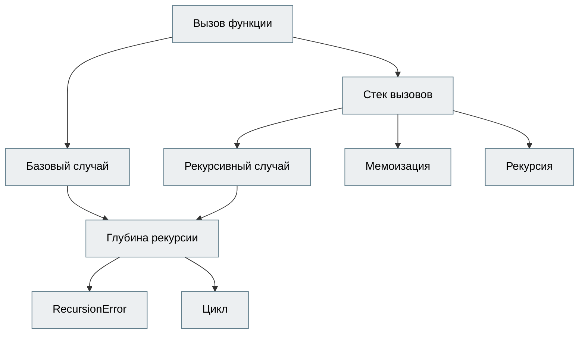

# Ustaz

Учебная платформа, где курс - это **карта понятий**, а не плейлист уроков. Преподаватель загружает свои лекции,
ИИ раскладывает их на понятия со связями «что нужно понять раньше» и пишет вопросы. Студент отвечает своими
словами, а платформа ведёт для каждого понятия вероятность того, что он его действительно понял, и следит,
когда он начнёт его забывать.

Чем это не Coursera:

| Обычная платформа | Ustaz |
|---|---|
| Курс - список видео, прогресс = «просмотрено 7 из 12» | Курс - граф понятий, прогресс = вероятность знания каждого понятия |
| Тесты с вариантами, угадал - засчитано | Открытые ответы, ИИ ищет в ответе ключевые пункты и **заблуждения** |
| Все начинают с первого урока | Диагностика бинарным поиском по карте: знаешь сложное - базу засчитает без вопросов |
| Прошёл курс - забыл | Кривая забывания: понятие «выцветает», и его вернут на повторение вовремя |
| Чат-бот выдаёт ответ на тест | Тьютор видит открытый вопрос и переходит в режим Сократа: наводит, но не отвечает за тебя |
| Преподаватель видит оценки | Преподаватель получает бриф: в чём именно путается группа и что разобрать на следующем занятии |

## Как это работает

```
лекции (.md/.txt) ─► MaterialLoader ─► разделы по заголовкам ─► понятия (по разделу) ─► связи (по всей карте)
                                   └─► фрагменты ─► эмбеддинги ─► InMemoryVectorStore (файл stores/course_N.json)
понятие + фрагменты лекции ─► 3 вопроса: recall / apply / analyze ─► преподаватель правит ─► публикация

студент: /next ─► планировщик (диагностика → повторение → новое) ─► вопрос
         /answer ─► грейдер (score, пункты, заблуждение) ─► BKT + устойчивость памяти ─► зачёт предпосылок
         /tutor ─► объясни по лекции | Сократ | «в курсе этого нет»
         /coach ─► агент с инструментами: прогресс, почему застрял, план занятия, ошибки, поиск по лекциям
```

Карта, которую qwen2.5:7b собрала из `materials/recursion.md` (9 понятий, 27 вопросов):



Не идеальна («Мемоизации» честнее опираться на «Рекурсивный случай»), поэтому перед публикацией её правит
преподаватель: `PUT /courses/concepts/{id}/`.

### Модель знаний (mastery/)

- **BKT** (Bayesian Knowledge Tracing): у каждого понятия вероятность `p_known`. Ответ - это свидетельство,
  но грейдер ставит не «верно/неверно», а score от 0 до 1, поэтому апостериорная вероятность - смесь двух
  байесовских апдейтов с весом score. На сложном вопросе угадать труднее, и он весит больше.
- **Забывание**: `помнишь = p_known · e^(-дней / устойчивость)`. Удачный ответ умножает устойчивость в 2,2-2,5 раза,
  провал делит пополам. Повторение назначается, когда «помнишь» падает до 75%.
- **Карта**: понятие открыто, когда все его предпосылки ≥ 60%; освоено от 85%. Из открытых первым идёт то, что
  откроет больше всего зависимых понятий.
- **Диагностика**: спрашиваем самое глубокое непроверенное понятие. Ответил - понятие и вся его база
  засчитываются. Не ответил - спускаемся к его предпосылкам. Три вопроса вместо двадцати.
- **«Почему я застрял»**: от понятия вниз по самым слабым предпосылкам, пока не упрёмся в твёрдо освоенное.

## Какие инструменты LangChain где

| Команда | Где | Зачем |
|---|---|---|
| `init_chat_model`, `init_embeddings` | `ai/llm.py` | Модель и эмбеддинги из строки `провайдер:модель` в `.env`, Ollama меняется на другого провайдера без правки кода |
| `ChatPromptTemplate.from_messages` | все цепочки в `ai/` | Промпты с переменными |
| `MessagesPlaceholder` | `ai/tutor.py` | История диалога внутри промпта |
| `FewShotChatMessagePromptTemplate` | `ai/grader.py` | Два эталонных примера оценки, чтобы модель держала шкалу |
| `.partial()` | `ai/grader.py` | Вшить инструкции формата в запасной промпт |
| `with_structured_output(Pydantic)` | forge, grader, insight | Понятия, связи, вопросы, оценка и бриф - сразу объектами |
| `PydanticOutputParser` + `get_format_instructions` | `ai/grader.py` | Запасной путь, если structured output не сработал |
| `StrOutputParser` | `ai/tutor.py` | Текст ответа тьютора |
| `RunnableParallel`, `itemgetter` | `ai/forge.py` | Контекст из ретривера и поля понятия собираются параллельно |
| `RunnablePassthrough.assign` | `ai/tutor.py` | Цепочка накапливает `standalone`, `docs`, `mode`, `answer` в одном dict |
| `RunnableBranch` | tutor, grader | Выбор режима тьютора; правило/защита/LLM в грейдере |
| `RunnableLambda(func, afunc=...)` | `ai/tutor.py` | Свои шаги с синхронной и асинхронной версией |
| `.with_retry()` | forge, grader | Повтор при сбое модели |
| `.with_fallbacks()` | `ai/grader.py` | structured output → JSON по инструкции → эвристика по ключевым пунктам |
| `.abatch(..., max_concurrency)`, `return_exceptions` | forge, insight | Вопросы ко всем понятиям и map-шаг брифа пачкой; одна ошибка не валит всю сборку |
| `.ainvoke`, `.astream` | API | Асинхронные вызовы и поток ответа тьютора по SSE |
| `RunnableConfig`: `run_name`, `tags`, `metadata`, `callbacks` | `ai/llm.py` | Подписанные запуски и учёт расходов |
| `BaseLoader` (свой `MaterialLoader`) | `ai/loader.py` | Материалы из БД превращаются в `Document` |
| `Document` + metadata | `ai/loader.py` | Раздел и файл едут вместе с текстом до ссылок `[1]` |
| `MarkdownHeaderTextSplitter` | `ai/loader.py` | Разделы по заголовкам лекции |
| `RecursiveCharacterTextSplitter` | `ai/loader.py` | Фрагменты для поиска и дорезка длинных разделов |
| `InMemoryVectorStore` + `dump`/`load` | `ai/knowledge.py` | Векторы считаются один раз при сборке и лежат в файле |
| `similarity_search_with_score` | `ai/knowledge.py` | Score нужен, чтобы понять «в курсе этого нет» |
| `BaseRetriever` (свой `CourseRetriever`) | `ai/knowledge.py` | Ретривер одного курса с порогом релевантности, работает в LCEL как Runnable |
| `BaseChatMessageHistory` (свой `SQLChatHistory`) | `ai/history.py` | История тьютора в SQLite |
| `RunnableWithMessageHistory` | `ai/tutor.py` | Сам подгружает и сохраняет историю по `session_id` |
| `trim_messages` | `ai/tutor.py` | Длинная история режется по бюджету токенов |
| `message_to_dict` / `messages_from_dict` | history, cache | Сериализация сообщений в JSON |
| `create_agent` | `ai/coach.py` | Агент-коуч |
| `@tool` + `ToolRuntime[Context]` | `ai/coach.py` | Инструменты получают student_id из контекста, а не от модели: чужой прогресс не подсмотреть |
| `context_schema` | `ai/coach.py` | Типизированный контекст запуска агента |
| `@dynamic_prompt` | `ai/coach.py` | Системный промпт с именем студента, курсом и временем |
| `@wrap_model_call` (свой `ground_first`) | `ai/coach.py` | Ответил без инструментов - переспросить один раз: коуч не говорит «из головы» |
| `ModelCallLimitMiddleware`, `ToolCallLimitMiddleware` | `ai/coach.py` | Агент не уйдёт в бесконечный цикл |
| `SummarizationMiddleware` | `ai/coach.py` | Длинный разговор с коучем сжимается |
| `InMemorySaver` + `thread_id` | `ai/coach.py` | Коуч помнит разговор с каждым студентом отдельно |
| `BaseCallbackHandler` (свой `UsageCallback`) | `ai/usage.py` | Каждый вызов модели: токены, задержка, кэш, ошибки → `/insight/usage/` |
| `BaseCache` (свой `SQLCache`) + `set_llm_cache` | `ai/cache.py`, `main.py` | Пересборка курса не гоняет модель по неизменённым разделам, одинаковый ответ = одинаковая оценка |
| `BaseChatModel`, `Embeddings` (свои фейки) | `tests/conftest.py` | Тесты всего пути без Ollama |

`ChatOllama` и `OllamaEmbeddings` никуда не делись: их создаёт `init_chat_model('ollama:...')`. `TextLoader` из
`langchain-community` не используется: этот пакет закрывают (sunset), а материалы приходят через API, поэтому
загрузчик свой, на `BaseLoader`.

## Что выяснилось на живой модели (qwen2.5:7b)

- **Поле со значением по умолчанию модель пропускает.** `requires: list[str] = Field(default_factory=list)` в
  JSON-схеме необязательное: в `reason` модель пишет «опирается на стек вызовов», а `requires` оставляет пустым.
  Поэтому в схемах для LLM поля без default.
- **Связи одним запросом по всей карте 7B не тянет.** Модель то вытягивала карту в цепочку по порядку лекции,
  то делала звезду с одним хабом. Помог маленький вопрос на каждое понятие («что из уже объяснённого нужно, чтобы
  понять это?») плюс транзитивная редукция в коде. Цикл так не возникнет: выбирать можно только из того, что раньше.
- **Без `num_predict` модель изредка зацикливается внутри JSON** и генерирует, пока не забьёт окно в 8k токенов.
- **Порог Сократа подобран замером bge-m3:** перефраз открытого вопроса даёт ~0.8, соседние темы курса 0.3-0.5.
  Явную просьбу «скажи ответ» ловим по исходному тексту: переписанный с историей вопрос тянет в себя тему
  открытого вопроса.
- **Коуч зовёт инструменты только на первом сообщении**, дальше отвечает общими словами. Принудить через
  `tool_choice` Ollama не умеет, поэтому есть middleware `ground_first`: второй шанс с требованием. Помогает не всегда:
  на «план на 15 минут» qwen2.5:7b и со второй попытки отвечал без `plan_session`.
- **Грейдер приписывал заблуждения неполным ответам** («не помню» → «мемоизация уменьшает глубину»), и правка
  промпта не помогла. Теперь заблуждение засчитывается, только если хотя бы треть его слов есть в самом ответе
  (`grounded` в `ai/grader.py`): лучше пропустить заблуждение, чем обвинить студента в чужом.
- `InMemoryVectorStore` без `numpy` падает на поиске, а `abatch(return_exceptions=True)` прячет это в список
  исключений: сборка честно писала «ни одного вопроса», пока в ошибку не стал попадать текст исключения.

## Запуск

Нужна Ollama с моделями `qwen2.5:7b` (вызывает инструменты и держит JSON-схемы) и `bge-m3` (многоязычные эмбеддинги).

```bash
ollama pull qwen2.5:7b && ollama pull bge-m3
python -m venv .venv && .venv/bin/pip install -r requirements.txt
cp .env.example .env        # SECRET_KEY: python -c "import secrets; print(secrets.token_hex(32))"
.venv/bin/python seed_demo.py   # демо-курс «Рекурсия в Python», на CPU 10-20 минут
.venv/bin/python main.py        # http://127.0.0.1:8001/docs
```

`seed_demo.py` создаёт преподавателя `teacher@ustaz.kg / teacher123`, студента `student@ustaz.kg / student123`
и собирает курс из `materials/recursion.md`. Повторный запуск берёт ответы модели из SQL-кэша: первая сборка
шла 26 минут на загруженном CPU, повторная - 6 секунд. В Swagger есть кнопка Authorize. В Postman импортируй
`Ustaz.postman_collection.json` и запускай папки по порядку: токены, id курса и вопроса сохраняются в переменные сами.

Другая модель задаётся через `.env`: `LLM_MODEL=ollama:llama3.1:8b`, `LLM_MODEL=google_genai:gemini-2.5-flash`
(нужен пакет `langchain-google-genai` и ключ) и так далее.

## Сценарий

1. **Преподаватель**: `POST /courses/` → `POST /courses/{id}/materials/upload/` (файл .md) → `POST /courses/{id}/build/`
   → следить за `progress` в `GET /courses/{id}/` → `GET /courses/{id}/map/` (поле `mermaid` вставляется в mermaid.live)
   → поправить карту `PUT /courses/concepts/{id}/` (предпосылки - списком id, цикл не пропустит), вопросы
   `PUT /courses/questions/{id}/` или добавить свой `POST /courses/concepts/{id}/questions/`
   → `POST /courses/{id}/publish/`. После публикации карта заморожена, чтобы не сбить прогресс студентов.
2. **Студент**: `POST /learn/{id}/enroll/` → `GET /learn/{id}/next/` → `POST /learn/{id}/answer/` и так по кругу.
   В ответе есть разбор, заблуждение, эталон, как изменилось знание, что засчитано и что открылось.
   `GET /learn/{id}/map/` - личная карта, раскрашенная по знаниям.
3. **Тьютор**: `POST /tutor/{id}/ask/` или `/stream/` (SSE). Спроси про открытый вопрос - получишь наводящий
   вопрос вместо ответа. Спроси не по курсу - честный отказ без вызова модели.
4. **Коуч**: `POST /coach/{id}/chat/` - «как у меня дела?», «почему не даётся мемоизация?», «план на 15 минут».
5. **Преподаватель**: `GET /insight/{id}/concepts/` - где спотыкаются, `POST /insight/{id}/brief/` - план занятия,
   `GET /insight/usage/` - расход модели по фичам.

## Тесты

```bash
.venv/bin/python -m pytest -q
```

Без Ollama, за секунды: фейковая модель на настоящем `bind_tools` (поэтому `with_structured_output` и
`create_agent` идут штатным путём LangChain) и игрушечные эмбеддинги. Проверяются сборка карты (склейка дублей,
удаление транзитивных связей), диагностика, защита от подмены вопроса и промпт-инъекции в ответе, все режимы
тьютора и стрим, инструменты коуча, аналитика, кэш и деградация грейдера до эвристики.

## Структура

```
api/        auth, course (преподаватель), learn (студент), tutor, coach, insight
ai/         llm, loader, knowledge, forge, grader, tutor, history, coach, insight, usage, cache
mastery/    bkt (знание и забывание), graph (карта), planner (что дальше), state (чтение из БД, mermaid)
database/   модели SQLAlchemy и схемы Pydantic
materials/  демо-лекция
tests/      фейки LangChain, сквозной сценарий, юнит-тесты модели знаний
```
